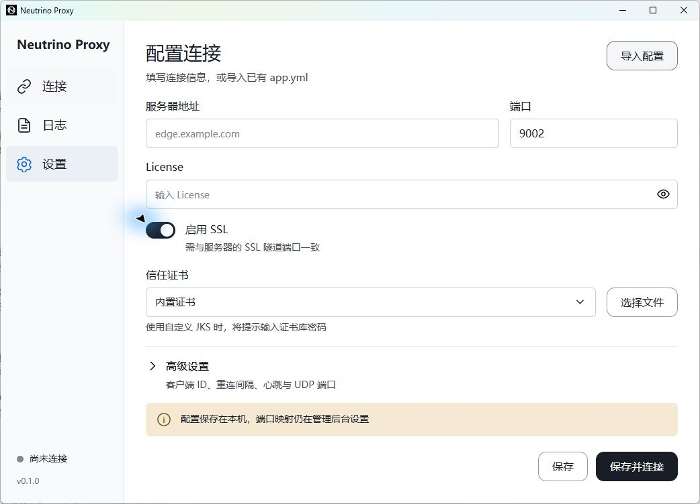
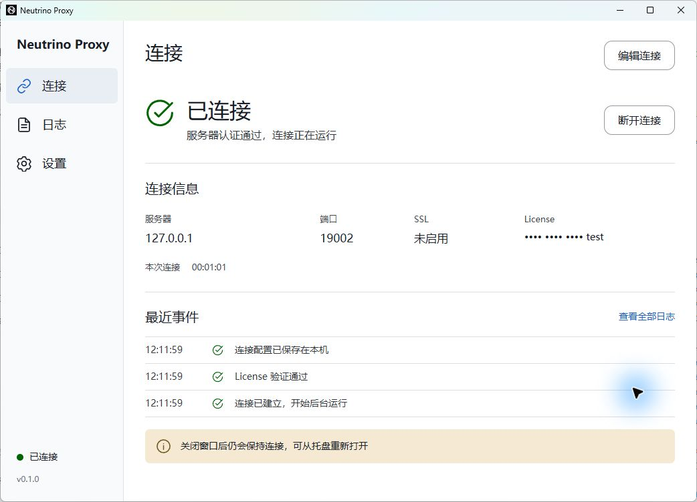

# 桌面客户端开发进展与验证记录

状态：Review  
最后更新：2026-10-15  
关联文档：[总体方案](../00-project/client-app-proposal.md)、[界面设计](../02-design/client-app-ui.md)、[架构设计](../03-architecture/client-app-architecture.md)、[完整验收计划](../04-quality/client-app-acceptance.md)、[本地运行](../05-operations/client-app-local-development.md)

## 当前里程碑

用户本轮要求为“开始重写客户端，直到软件能打开，页面一致”。在独立的 `neutrino-proxy-client-app/` 中实现 Rust / Tokio 内核、Tauri 2 宿主和 Vue 3 页面，形成 Windows 可直接运行的开发版本。当前版本为 0.1.0，用户于 2026-10-15 授权将源代码提交至 [GitHub 仓库](https://github.com/ynx-official/neutrino-proxy)。Windows 构建产物保留在本地工作区，尚未正式发布。

这份记录只说明当前实现与已执行的验证。完整迁移方案中的旧证书兼容、全部非默认参数、长期资源测试、macOS 原生验收及安装包发布仍需后续完成。

## 已实现

| 部分 | 当前行为 |
|---|---|
| 桌面程序 | Windows 原生 exe，内嵌前端资源；启动不依赖 Vite、命令行窗口或 Java |
| 页面 | 按 `airtable` 样图实现连接、日志、设置三页；浅色导航、连接摘要、最近事件、基础表单和高级折叠区 |
| 配置 | 地址、端口、License、SSL、证书、客户端 ID、重连间隔、心跳、读超时、UDP 范围；Rust 再次校验输入 |
| 本地持久化 | 原子替换普通配置文件；License 和 JKS 密码使用系统安全存储；界面只接收掩码摘要 |
| 通信内核 | 原有二进制帧格式、认证、心跳、读超时、网络重连、认证失败停止、手动断开和取消；TCP / UDP 双向转发 |
| 资源边界 | 共享 2 个异步工作线程，阻塞任务池最多 4 个线程；连接任务、日志和事件有界，数据包不推送到前端 |
| 桌面生命周期 | 单实例；关窗销毁 WebView、Rust 保持运行；重复打开 exe 恢复窗口和状态；托盘提供连接、断开及退出入口 |
| 日志 | 当前会话脱敏日志、筛选、暂停视图更新、导出；当前内存最多 500 条、单条最多 512 字符 |
| 导入 | YAML 脱敏预览并显式确认；读取基本连接配置与部分高级参数，不修改原文件；已知不支持的协议参数阻止应用 |
| 开发基础 | npm / Cargo 锁文件、组件与浏览器测试、Rust 测试和 Clippy、Windows/macOS CI 工作流 |

## 已执行的验证

| 检查 | 本机结果 | 覆盖与限制 |
|---|---|---|
| `cargo test -p neutrino-client-core` | 12 个测试通过 | 原字节格式、半包、Unicode / 二进制、异常长度、配置错误、内置 JKS 读取、短凭证掩码、认证与取消、TCP / UDP 回传 |
| `cargo clippy --workspace --all-targets -- -D warnings` | 通过 | Rust 静态检查，不等同于网络兼容性或内存测试 |
| `cargo fmt --all --check` | 通过 | Rust 格式检查 |
| `npm test` | 5 个测试通过 | 首次配置校验、保持已存凭证、异步加载配置、初始状态、断开操作 |
| `npm run test:e2e` | 4 个流程通过 | 表单与导航、已连接信息层级和日志筛选、最小尺寸与长地址、默认配置页无需多余滚动；使用明确的 IPC 测试替身 |
| `npm run desktop:build` | Windows Release 构建成功 | 生成可直接运行的 exe；不是安装包签名或发布验收 |
| Windows 原生窗口 | 已实际打开并检查 | `computer-use` 读取真实窗口和控件；核对页面、表单、状态和导航 |
| 原生保存并连接 | 本地测试对端认证成功 | 从实际窗口填入虚构 License；确认状态由 Rust 认证结果驱动，配置文件不包含凭证明文 |
| 关窗和恢复 | 通过 | 关闭后窗口从原生窗口列表消失，Rust 进程及本地 TCP 连接仍在；重开 exe 保持同一进程、原连接及持续时间 |
| 整个程序重启 | 通过 | 保留连接参数与安全存储凭证，不自动连接；点击连接可再次认证成功 |

最小窗口回归测试曾复现保存按钮底部超出 620 像素，修正为固定可见的操作区后通过；默认窗口另有回归测试确认折叠状态的完整配置表单不产生多余滚动。断开与重连生命周期测试没有通过删除用例或跳过断言获得通过。认证帧固定向量依据所读 Java 编码代码构造，尚未建立完整的 Java 客户端对照矩阵。

本次原生测试对端仅监听 `127.0.0.1`，属于测试夹具，不是服务端产品改造。测试后已停止夹具，删除本次创建的测试配置与对应安全存储条目，让 App 回到未配置状态；没有使用真实 License 或连接生产服务。

## 实际运行截图

最终 Windows Release 已重新打开，停留在干净的配置页；完整基础表单在默认窗口内显示，没有多余滚动条：

最终 exe：`neutrino-proxy-client-app/target/release/neutrino-proxy-client-app.exe`，SHA-256 为 `906229aa3f098361c1dd69808bc7152240dadf448cb8e1216cfb478058695ac0`。

Windows 原生窗口通过本地测试对端认证后的状态：

截图中的地址、端口与凭证均为本机测试数据，与设计样图中的示例域名不同。运行截图证明页面和状态已在原生窗口中呈现，不能据此推导出真实服务兼容、吞吐或长期内存表现。

## 后续迁移与验收

- macOS 源码路径与 CI 已准备，但本机为 Windows，尚未执行 macOS 构建、菜单栏、窗口及系统安全存储验证；远程构建结果以 [GitHub Actions](https://github.com/ynx-official/neutrino-proxy/actions) 的实际运行记录为准。
- JKS 可直接读取，但当前 TLS 按证书链、有效期和服务器名称验证。旧 Java 行为差异仍需真实的脱敏证书矩阵验证，不提供忽略证书错误的开关。
- 当前未完整迁移自定义帧布局、水位线、全空闲超时和所有框架专用参数；不能宣称旧配置已经全部无损兼容。
- 当前不复用空闲数据隧道池；TCP / UDP 基础转发已验证，但池化、并发容量、慢连接压力、异常 UDP 回收和全部路由场景仍需扩大测试。
- 当前日志为内存记录与手动导出，退出后不会保留完整历史；尚未实现滚动日志文件和系统登录自动启动。
- 托盘退出当前直接结束连接，活动传输确认和更细的托盘状态操作仍需补齐。
- 未运行 72 小时稳定性、Java 对照基线、完整进程树内存和吞吐测试；不承诺固定 MB 占用或性能提升比例。
- 尚未生成安装程序、签名、公证、自动更新或正式发布。

## 下一阶段顺序

按[实施计划](client-app-implementation-plan.md)补全旧配置与 TLS 兼容测试、转发并发和资源回收，再执行双平台及长期运行验收。当前可运行里程碑的完成不代表全部阶段已经完成。
